  

  A solo exhibition by rekyi · on view since July 2026

### Featured works

<table>
  <tr>
    <td width="50%" valign="top">
      
        
      <b>Hollowbloom</b>, <i>2026</i> 
      JavaScript, HTML5 Canvas, LDtk, howler.js
      
A 2D action platformer with a hand-written game loop, immersive world, and a two-phase final boss.

      <a href="https://hollowbloom.rekyi.de">Play ↗</a> &nbsp;·&nbsp; <a href="https://github.com/rekyi/hollowbloom">Source ↗</a>
    </td>
    <td width="50%" valign="top">
      
        
      <b>Pokédex</b>, <i>2026</i> 
      JavaScript, PokéAPI
      
Every Pokémon as a trading card, loaded on demand, with a holographic detail view.

      <a href="https://pokedex.rekyi.de">Open ↗</a> &nbsp;·&nbsp; <a href="https://github.com/rekyi/pokedex">Source ↗</a>
    </td>
  </tr>
</table>

### Also in the collection

| Work                                                                                                   | Medium                            |                                                     |
| :----------------------------------------------------------------------------------------------------- | :-------------------------------- | :-------------------------------------------------- |
| **rekyi.de**, _2026_ Personal portfolio in two languages, mobile-first up to widescreen | Angular 22, TypeScript, SCSS, PHP | [Visit ↗](https://rekyi.de)                         |
| **WoW Forever Addons**, _2026_ My old Classic addons overhauled                         | Lua                               | [Source ↗](https://github.com/rekyi/forever-addons) |

### Currently learning

| Focus          | Stack                         | Status      |
| :------------- | :---------------------------- | :---------- |
| Backend APIs   | Python, Django REST Framework | in progress |
| Databases      | PostgreSQL, Redis, Django ORM | next        |
| Deployment     | CI/CD, cloud hosting, Sentry  | planned     |
| AI integration | RAG, AI agents, n8n           | planned     |

### Recent activity

<!-- ACTIVITY:START -->

| Date | Activity | Repository |
| :-- | :-- | :-- |
| Nov 21 | Pushed | [portfolio](https://github.com/rekyi/portfolio) |
| Nov 20 | Pushed ×4 | [portfolio](https://github.com/rekyi/portfolio) |
| Nov 19 | Pushed ×2 | [portfolio](https://github.com/rekyi/portfolio) |
| Nov 19 | Pushed | [pokedex](https://github.com/rekyi/pokedex) |
| Nov 19 | Pushed | [hollowbloom](https://github.com/rekyi/hollowbloom) |
| Nov 19 | Pushed ×3 | [pokedex](https://github.com/rekyi/pokedex) |

<!-- ACTIVITY:END -->

### Materials

 

---

  
    Enquiries: <a href="mailto:mail@rekyi.de">mail@rekyi.de</a> · Catalogue: <a href="https://rekyi.de">rekyi.de</a> 
    Both artworks on this page are regenerated every night by a GitHub Action. Come back tomorrow, they will have grown.
  

